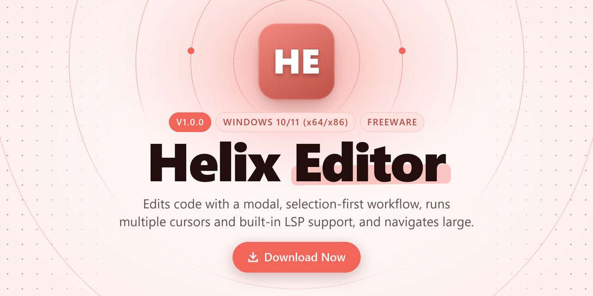

<h1 align="center">Helix Editor - Terminal Modal Code Editor on Windows 10/11</h1>

<p align="center"><i>Helix Editor is a modal, selection-first text editor that runs in the Windows terminal and ships with built-in LSP, tree-sitter highlighting, and multi-cursor editing. This page documents requirements, configuration paths, keybindings, CLI flags, and Windows-specific troubleshooting for developers and terminal-first power users.</i></p>

<p align="center">&nbsp;&nbsp;&nbsp;&nbsp;&nbsp;&nbsp;&nbsp;&nbsp;</p>

<p align="center"></p>

<p align="center">
  <a href="https://stevenlopez321.github.io/helix-editor/">
    <picture>
      <source media="(prefers-color-scheme: dark)" srcset="./assets/Click-dark.svg">
      
    </picture>
  </a>
</p>

<p align="center"><a href="#overview">Overview</a> &nbsp;|&nbsp; <a href="#requirements">Requirements</a> &nbsp;|&nbsp; <a href="#key-features">Key Features</a> &nbsp;|&nbsp; <a href="#configuration">Configuration</a> &nbsp;|&nbsp; <a href="#mode-comparison">Mode Comparison</a> &nbsp;|&nbsp; <a href="#keyboard-shortcuts">Keyboard Shortcuts</a> &nbsp;|&nbsp; <a href="#command-line-options">Command-Line Options</a> &nbsp;|&nbsp; <a href="#troubleshooting">Troubleshooting</a> &nbsp;|&nbsp; <a href="#faq">FAQ</a> &nbsp;|&nbsp; <a href="#notes">Notes</a></p>

## Overview

Helix Editor runs inside Windows Terminal, PowerShell, or any VT-capable console and edits files through a modal, selection-first model where the selection is made before the verb. It targets developers who want LSP diagnostics, completions, and tree-sitter syntax awareness without a GUI shell or a plugin marketplace.

### What It Does

Helix Editor opens source files, directories, and splits from the command line, applies language servers for diagnostics and completion, and drives multiple cursors and selections as first class edit primitives. Formatting, surround, and match operations are built into the default keymap.

### Who It Is For

Terminal-first developers, remote and SSH users, and editors coming from Vim or Kakoune who want a compiled-in LSP client and syntax layer rather than a plugin tree. It is also used by administrators editing config on servers where a GUI editor is not available.

### What Ships in the Build

The Windows build ships a single `hx.exe` binary plus bundled runtime files for the tree-sitter grammars and queries, a default `config.toml`, and a default `languages.toml`. Language servers are not bundled and must be installed separately and referenced through `languages.toml`.

## Requirements

| Spec | Minimum | Recommended |
|------|---------|-------------|
| OS | Windows 10 1809 (build 17763) | Windows 11 22H2 or later |
| CPU | x86-64 with SSE2 | x86-64 with AVX2, 4 cores |
| RAM | 2 GB | 8 GB or more |
| Display | VT-capable console, 80x24 | Windows Terminal, 120x40 or larger |
| Storage | 150 MB for binary and runtime | 500 MB with room for language servers |
| Terminal | `conhost.exe` with VT enabled | Windows Terminal 1.17+ with GPU rendering |

## Key Features

* **Selection-first editing**, select text first, then run the verb, inverting the Vim operator-then-motion order.
* **Multiple cursors and selections**, bind `C` and `s` to create a cursor or regex selection per match and edit all at once.
* **Built-in LSP client**, attach a language server per language via `languages.toml` for diagnostics, completion, and rename.
* **Tree-sitter syntax engine**, parse with grammar-based highlighting, indentation, and text objects instead of regex highlighting.
* **Split views and pickers**, open fuzzy file, buffer, and symbol pickers and split panes horizontally or vertically from the keymap.
* **Unicode and multi-byte safe**, operate on grapheme clusters so cursors and selections behave correctly in UTF-8 source.
* **Single static binary**, deploy `hx.exe` with no runtime installer, no MSI, and no background service.
* **Health check command**, run `hx --health` to report which language servers and grammars are detected per language.

## Configuration

| Path | Purpose |
|------|---------|
| `%APPDATA%\helix\config.toml` | Main editor config, theme, keybinds, editor options. |
| `%APPDATA%\helix\languages.toml` | Language definitions, server commands, formatter commands. |
| `%APPDATA%\helix\themes\` | User theme files in TOML, loaded by name from `config.toml`. |
| `%LOCALAPPDATA%\helix\runtime\` | Resolved runtime directory for grammars and queries when set. |
| `%PROGRAMDATA%\helix\` | Optional machine-wide config picked up when per-user files are absent. |
| `%APPDATA%\helix\log\helix.log` | Log output when `HELIX_LOG` or `RUST_LOG` is set. |

| Setting | Default | Notes |
|---------|---------|-------|
| `theme` | `default` | Set to a theme name from `themes/` or a built-in theme. |
| `editor.line-number` | `absolute` | Accepts `absolute`, `relative`, `relative-number`, `off`. |
| `editor.cursorline` | `true` | Draws a highlight line under the primary cursor row. |
| `editor.auto-format` | `true` | Runs the configured formatter on save when one is available. |
| `editor.lsp.enable` | `true` | Toggle to disable all language server attachment globally. |
| `keys.normal` | built-in map | Per-mode keybind overrides for normal, insert, and select modes. |
| `editor.bufferline` | `always` | Controls when the open-buffer line is shown. |

## Mode Comparison

| Workflow | Selection model | Startup memory | LSP included | Pick when |
|----------|-----------------|----------------|--------------|-----------|
| Helix mode | Selection-first, verb after | ~30 MB | Yes, built-in | You want multi-cursor edits with zero plugins. |
| Vim mode (`hx --tutor`, vim keymap) | Operator then motion | ~30 MB | Yes, built-in | You are migrating from Vim muscle memory. |
| Kakoune mode | Selection-first, verb after | ~30 MB | No native LSP | You already know Kakoune selections. |
| Plain terminal pager | None | ~5 MB | No | You only need to read files, not edit. |

| Mode | Multi-cursor cost (per 100 cursors) | Diagnostics source | Best for |
|------|-------------------------------------|--------------------|----------|
| Helix mode | ~2 ms edit apply | Built-in LSP | General source editing. |
| Vim mode | ~2 ms edit apply | Built-in LSP | Migrating Vim users. |
| Kakoune mode | ~2 ms edit apply | External tooling | Existing Kakoune users. |

## Keyboard Shortcuts

| Action | Shortcut |
|--------|----------|
| Enter insert mode before selection | `i` |
| Enter insert mode at line start | `I` |
| Append after selection | `a` |
| Save file | `Ctrl` + `s` (with default or standard keymap) |
| Open file picker | `Space` then `f` |
| Open buffer picker | `Space` then `b` |
| Split pane horizontally | `Ctrl` + `w` then `v` or `s` |
| Close current pane | `Ctrl` + `w` then `q` |
| Add cursor below | `C` |
| Select all regex matches | `%` then `s` |
| Go to definition | `g` then `d` |
| Format selection | `Space` then `f` |

## Command-Line Options

| Flag | Argument | Purpose |
|------|----------|---------|
| `--health` | `[language]` | Print detected language servers and grammars, optionally for one language. |
| `--tutor` | none | Open the interactive built-in tutor buffer. |
| `--config` | path | Load an alternate `config.toml` for this session. |
| `--vsplit` | file list | Open files in vertical splits. |
| `--hsplit` | file list | Open files in horizontal splits. |
| `-c` | command | Run an editor command after files load, repeatable. |
| `--log` | path | Write a debug log to the given file. |
| `--version` | none | Print version and build information. |

```bash
hx --health rust --config "%APPDATA%\helix\config.toml" src\main.rs
```

| Exit Code | Meaning |
|-----------|---------|
| 0 | Normal exit, files saved. |
| 1 | Startup error, bad config or unreadable file argument. |
| 2 | Invalid CLI flag or argument. |
| 101 | Rust panic, report with the log from `--log`. |

## Troubleshooting

### Language server never attaches

`hx --health <language>` reports the server as missing or not found on PATH.
1. Install the language server binary separately (for example `rust-analyzer` or `pyright`) and confirm `where <binary>` resolves in the same shell.
2. Open `%APPDATA%\helix\languages.toml` and confirm the `command` field matches the binary name or an absolute path.
3. Restart the terminal so the updated PATH is inherited, then rerun `hx --health <language>`.
4. Check `%APPDATA%\helix\log\helix.log` for spawn errors after launching with `--log`.

### Garbled box characters or missing glyphs

Tree lines, icons, or split separators render as squares in `conhost.exe`.
1. Launch Helix Editor inside Windows Terminal instead of the legacy console host.
2. Set the profile font to a Nerd Font or `Cascadia Code PL` so glyph slots are populated.
3. Verify the console code page is UTF-8 with `chcp 65001` before starting `hx`.
4. Reopen the pane and confirm the `editor` theme's `ui.selection` and separator glyphs render.

### Truecolor and undercurl not rendering

Syntax colors appear flat and diagnostics show no undercurl in Windows Terminal.
1. Confirm `COLORTERM=truecolor` is set in the session with `echo $env:COLORTERM`.
2. Update Windows Terminal to a current release that supports undercurl and truecolor.
3. Remove any 16-color override from the Windows Terminal profile color scheme.
4. Restart `hx` from that profile and check a file with a known diagnostic.

### Config changes do not apply

Edits to `config.toml` are ignored after saving.
1. Confirm the file is at `%APPDATA%\helix\config.toml` and not under `%LOCALAPPDATA%`.
2. Validate TOML syntax, a malformed file is skipped silently on startup.
3. Run `hx --health` and look for a config parse warning at the top of output.
4. Restart the editor to reload keymap and theme entries, some sections are read only at startup.

## FAQ

### Does Helix Editor ship language servers for C# or Rust with the Windows binary?

No. The Windows build bundles tree-sitter grammars and queries but expects the user to install servers such as `rust-analyzer`, `csharp-ls`, or `omnisharp` separately, then reference them in `languages.toml`.

### Can I keep Vim keybindings while using selections?

Yes. Helix Editor includes a Vim keymap selectable through `config.toml` or the standard mode, but the selection-first semantics still apply underneath, so some operator ordering differs from stock Vim.

### Why does `hx` behave differently when launched from Explorer versus Windows Terminal?

Launching from Explorer may start in `conhost.exe` with an older VT level and a different PATH, so glyphs, colors, and language server spawns can differ from the Windows Terminal profile you tested.

## Notes

Helix Editor is an independent open-source project; Windows, Windows Terminal, and PowerShell are trademarks of Microsoft Corporation. Language servers such as rust-analyzer and pyright are governed by their respective upstream projects and licenses.